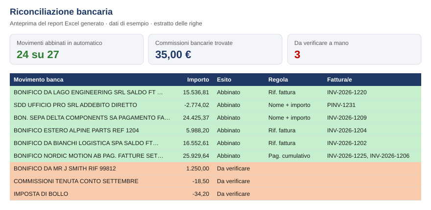

# Bank reconciliation – rules first, AI for the rest

Matches bank statement lines to open invoices automatically. Simple, auditable rules handle the bulk of the work; an AI step (Claude) proposes matches for the lines the rules can't solve, with a confidence score and a reason, so the accountant only reviews the exceptions.

> All names, invoices and amounts in this repository are **synthetic**.

📘 **[Guida in italiano: come replicarlo da un cliente](COME_REPLICARE.md)**

## The result



What the reader gets, in three numbers (sample data, one month of bank statement):

| Matched automatically | Bank fees found | Left to review |
|---:|---:|---:|
| **24 of 27** lines | **€ 35.00** | **3** lines |

The three lines left are exactly the ones that need a human: an unknown payer, the account fee and stamp duty.

## How it works

| Pass | Rule | Typical case |
|---|---|---|
| 1. Reference | Invoice number (or its numeric part) appears in the bank description | `SALDO FT INV-2026-1201` |
| 2. Name + amount | Same amount, counterparty name similar (fuzzy), date within 15 days of due date | `BON. SEPA DELTA COMPONENT PAGAMENTO FATTURA` |
| 3. Combined payment | One transfer equals the sum of two open invoices of the same customer | `PAG. FATTURE SETTEMBRE` |
| 4. AI suggestion | Remaining lines and open items are sent to Claude, which proposes a match and explains why | bank charges, stamp duty, unknown payers |

Payments short by a small amount (default ≤ 20) are matched and flagged as **bank fee deducted**.
AI proposals are never booked automatically: they are marked **to review**.

On the sample data the rules alone reconcile **24 of 27 lines (≈ 90%)**; the remaining 3 go to review.

## Quick start

```bash
pip install -r requirements.txt
python generate_sample_data.py     # creates data/bank_statement.csv and data/open_items.csv
python reconcile.py --no-ai        # rules only

# with the AI pass
export ANTHROPIC_API_KEY=...       # your own key
python reconcile.py
```

The result is an Excel file in `output/` with three sheets:

- **Summary** – matched / to review / unmatched, bank fees found, matches by rule
- **Bank lines** – every line with status (green = matched, yellow = AI suggestion, red = unmatched), rule used, documents and notes
- **Open items** – invoices still unpaid after reconciliation

## Using it with real data

| File | Source | Columns used |
|---|---|---|
| `data/bank_statement.xlsx` / `.csv` | Home-banking export | Booking Date, Description, Amount (or separate money-in / money-out columns) |
| `data/open_items.xlsx` / `.csv` | ERP customer + vendor ledger entries, open only | Document No., Customer/Vendor Name, Due Date, Remaining Amount |

- Excel or CSV, comma or semicolon separated, amounts as `1234.56` or `1.234,56`, dates as `30/09/2026` or `2026-09-30`
- Column names in English or Italian (e.g. *Data contabile*, *Entrate/Uscite*, *Nr. documento*, *Importo residuo*)

Step-by-step instructions, data requests and the checks to run before delivering are in the **[Italian guide](COME_REPLICARE.md)**.

## Possible extensions

- Read CAMT.053 / MT940 files directly
- Write matches back to the ERP as a payment reconciliation journal
- Learn from confirmed AI suggestions to add new rules

---

🇮🇹 **In breve:** riconciliazione bancaria automatica. Regole semplici e verificabili (riferimento fattura, nome + importo, pagamenti cumulativi, commissioni trattenute) abbinano la maggior parte dei movimenti; per quelli rimasti l'AI propone un abbinamento con motivazione e livello di confidenza, da confermare. Dati di esempio fittizi.

**Author:** [Daniele Marsico](https://github.com/daniele-marsico) · [ControllingHub](https://controllinghub.netlify.app)
